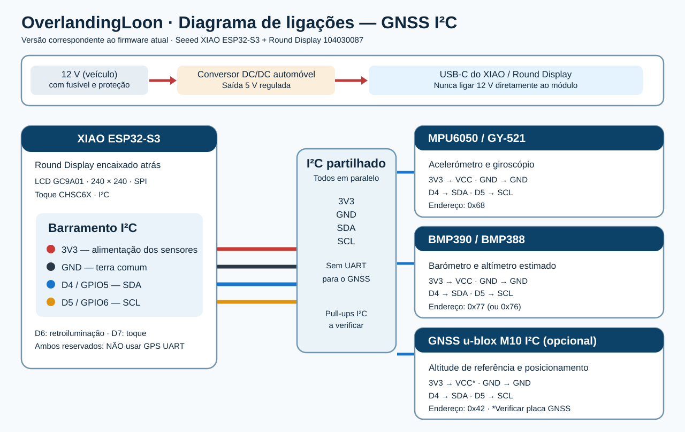

<p align="center"></p>

# OverlandingLoon

**Eletrónica embarcada, instrumentação e software para aventura e overlanding.**

Projeto da **SDL LABS** · documentação em português (Portugal)

---

## Visão geral

O **OverlandingLoon** reúne projetos de instrumentação, eletrónica e firmware para utilização em veículos de expedição e todo-o-terreno. A primeira implementação é um **inclinómetro digital para veículos 4×4**, baseado no Seeed XIAO ESP32-S3 e num ecrã tátil circular de 1,28″.

O firmware atual foi adaptado do projeto *Car Inclinometer* de **LazyDays Creation** e acrescenta medições barométricas e suporte **opcional** para correção de altitude por GNSS.

> **Estado do projeto: protótipo / desenvolvimento.** Código revisto estaticamente, mas **sem compilação reproduzível nem ensaio validado em hardware real**. Não utilizar os valores de inclinação para decisões críticas de segurança.

## Funcionalidades

| Função | Hardware | Estado |
|---|---|---|
| Inclinação longitudinal (*pitch*) e lateral (*roll*) | MPU6050 | Implementado no código; por validar |
| Mostrador circular 240 × 240 | Seeed Round Display / GC9A01 | Adaptado; por validar |
| Alternância de páginas por toque | CHSC6X | Implementado; por validar |
| Pressão atmosférica local (hPa) | BMP390 / BMP388 | Implementado; por validar |
| Altitude barométrica estimada (m) | BMP390 / BMP388 | Implementado; por validar |
| Referência barométrica estimada a partir de GNSS | u-blox M10 **I²C** | Opcional, desativado por omissão; por validar |
| Alimentação automóvel | Conversor 12 V → 5 V protegido | Recomendação de integração; não validada |

### Hardware de referência

- **Seeed Studio XIAO ESP32-S3** encaixado na traseira do **Round Display for XIAO**, SKU **104030087**.
- **MPU6050** (placa GY-521), acelerómetro e giroscópio.
- **BMP390**, pressão atmosférica e altitude barométrica.
- **Opcional: u-blox M10 com interface I²C** (por exemplo SparkFun SAM-M10Q). **O firmware atual não implementa GNSS por UART.**
- Fonte **5 V regulada** via USB-C; para instalação no veículo, usar conversor DC/DC automóvel com proteção adequada.

O MPU6050, o BMP390, o controlador tátil e o GNSS I²C partilham o mesmo barramento. **D6 e D7 já estão ocupados pelo ecrã** (retroiluminação e interrupção do toque); não os usar para ligar um GPS UART nesta versão.

## Começar

1. Consultar o [diagrama de ligações](docs/wiring.svg) e a [documentação do hardware](docs/hardware.md).
2. Montar o **XIAO ESP32-S3** no conector do ecrã e ligar os módulos I²C com níveis lógicos de **3,3 V**.
3. Abrir no Arduino IDE o ficheiro [`car-inclinometer-xiao-baro-gnss.ino`](firmware/car-inclinometer-xiao-baro-gnss/car-inclinometer-xiao-baro-gnss.ino), mantendo os restantes ficheiros da pasta.
4. Instalar **esp32 by Espressif Systems**, **LVGL 8.3.11**, **LovyanGFX**, **Adafruit MPU6050** e **Adafruit BMP3XX**, mais as dependências pedidas pelo Arduino IDE.
5. Selecionar **Seeed XIAO ESP32-S3** no Arduino IDE. Ativar o interruptor **KE** do ecrã na posição **ON**.
6. Se houver GNSS **I²C** u-blox M10, instalar também **SparkFun u-blox GNSS v3** e alterar `#define USE_GNSS_I2C 0` para `1` no sketch.
7. Compilar, carregar e testar primeiro em bancada, com os sensores imóveis e o módulo MPU6050 nivelado durante a calibração de arranque.

As instruções detalhadas e limitações encontram-se no [README do firmware](firmware/car-inclinometer-xiao-baro-gnss/README_PT.md).

## Ligações fundamentais

| XIAO ESP32-S3 | Destino | Notas |
|---|---|---|
| **3V3** | VCC dos módulos compatíveis com 3,3 V | Confirmar a especificação de cada breakout |
| **GND** | GND de todos os módulos | Terra comum |
| **D4 / GPIO5** | SDA do MPU6050, BMP390 e GNSS I²C opcional | Barramento I²C partilhado |
| **D5 / GPIO6** | SCL do MPU6050, BMP390 e GNSS I²C opcional | Barramento I²C partilhado |
| **D6 / GPIO43** | Retroiluminação do ecrã | **Reservado** |
| **D7 / GPIO44** | Interrupção do controlador tátil | **Reservado** |

O XIAO e o LCD ligam-se através do encaixe do Round Display, sem fios externos entre os dois. A alimentação principal é **5 V regulados para a placa**, não 12 V diretos para os GPIO ou para a entrada 5 V.



## Organização do repositório

```text
OverlandingLoon/
├── README.md
├── LICENSE                      # Apache-2.0 (repositório)
├── .gitignore
├── assets/
│   └── branding/
│       └── loon-overlanding-logo.png
├── docs/
│   ├── architecture.md          # Componentes e fluxo de medições
│   ├── hardware.md              # Pinagem, alimentação e montagem
│   ├── roadmap.md               # Estado e próximas etapas
│   └── wiring.svg               # Diagrama de ligações atual
└── firmware/
    └── car-inclinometer-xiao-baro-gnss/
        ├── car-inclinometer-xiao-baro-gnss.ino
        ├── LGFX_GC9A01.hpp
        ├── lv_conf.h
        ├── ui*                      # Interface LVGL e recursos exportados
        ├── README_PT.md
        └── LICENSE.md              # Licença MIT e atribuição ao original
```

## Documentação

- [Hardware, pinagem e cuidados automóveis](docs/hardware.md)
- [Arquitetura do sistema e limites das medições](docs/architecture.md)
- [Roadmap e validação pendente](docs/roadmap.md)
- [README técnico do inclinómetro](firmware/car-inclinometer-xiao-baro-gnss/README_PT.md)
- [Diagrama de ligações em SVG](docs/wiring.svg)

## Segurança e limitações

O indicador de inclinação **não é um instrumento homologado de segurança**. O MPU6050 pode interpretar acelerações em movimento como inclinação. A altitude barométrica depende da pressão de referência; um GNSS também apresenta erro vertical, especialmente com má visibilidade do céu. **A informação do ecrã deve ser interpretada como auxiliar.**

Para utilização em veículo: proteger a alimentação contra transientes, inversão de polaridade e sobrecorrente; instalar fusível e conversor próprio para ambiente automóvel. Manter os sensores longe de calor excessivo, humidade, vento direto e vibração não controlada.

## Créditos e licenças

- Projeto original *Car Inclinometer*: **LazyDays Creation**, © 2026, licença **MIT**. Os avisos e a licença originais estão preservados em [`firmware/.../LICENSE.md`](firmware/car-inclinometer-xiao-baro-gnss/LICENSE.md).
- Organização e documentação OverlandingLoon: **SDL LABS**.
- O repositório contém uma licença [Apache License 2.0](LICENSE) na raiz; **a existência desta licença não elimina nem substitui as obrigações de atribuição MIT associadas ao trabalho de terceiros**.
- Bibliotecas e hardware de terceiros seguem as respetivas licenças e documentação.

---

*OverlandingLoon — SDL LABS · Electronics & Software for Overlanding*
